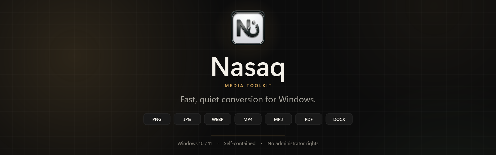
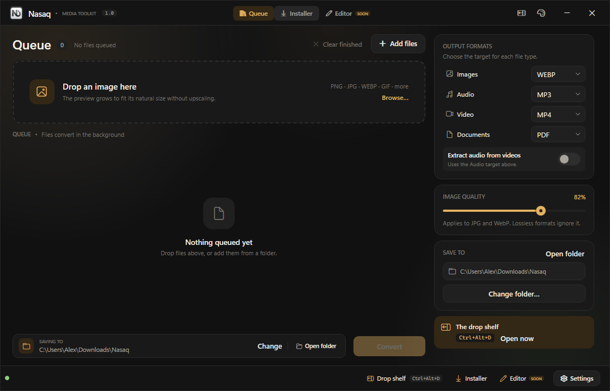
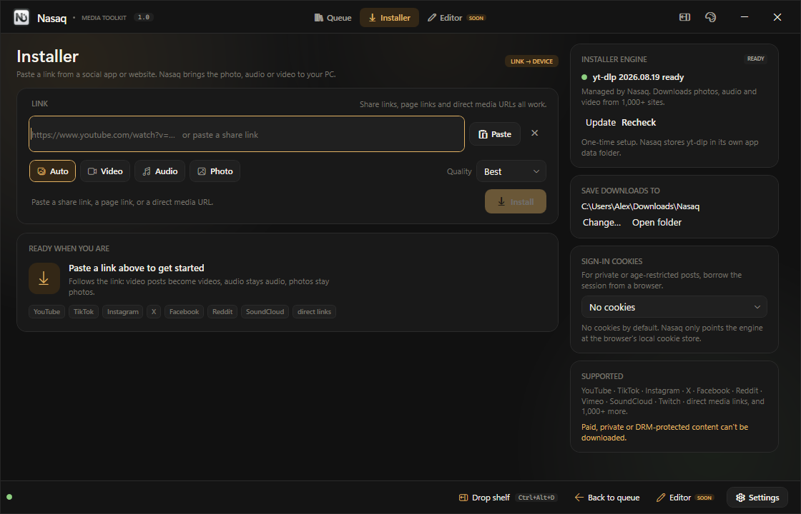
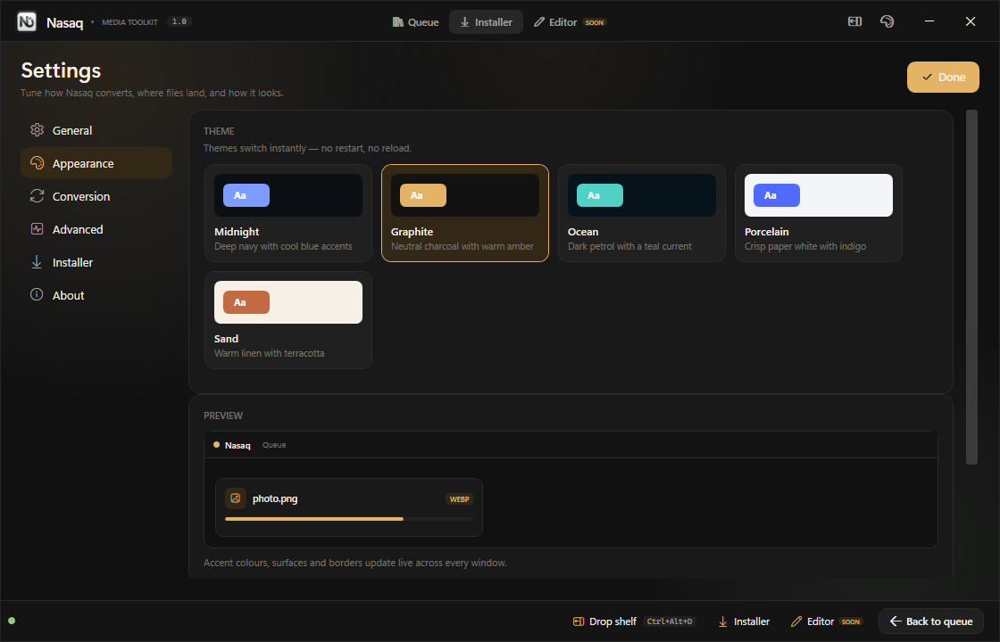
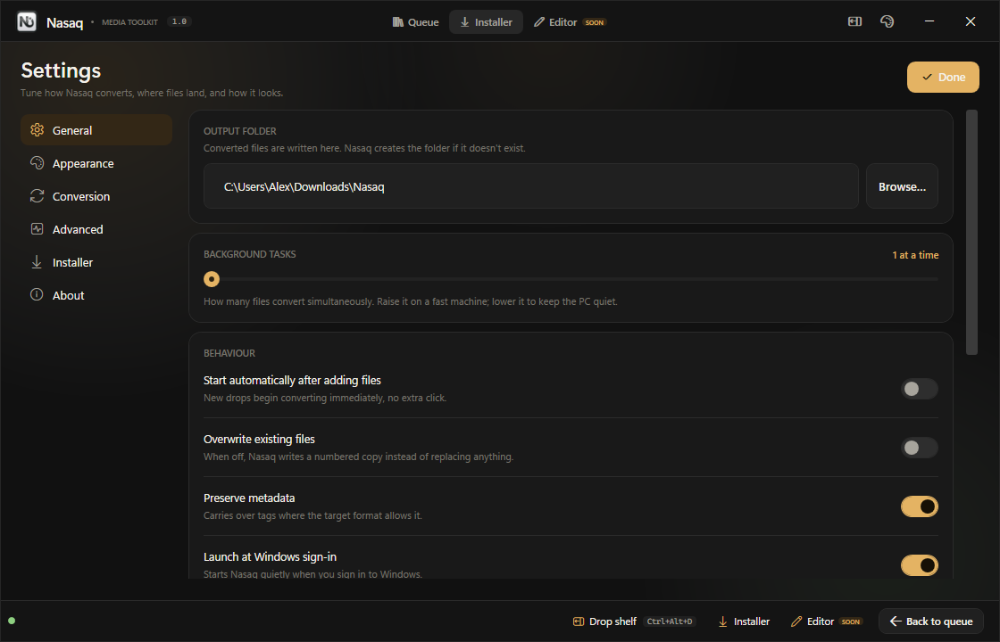

<p align="center">
  
</p>

<p align="center">
  <a href="https://github.com/Haaloww/Nasaq/releases/latest">
    
  </a>
</p>

<p align="center">
  <a href="https://github.com/Haaloww/Nasaq/releases/latest"></a>
  <a href="https://github.com/Haaloww/Nasaq/releases"></a>
  <a href="https://github.com/Haaloww/Nasaq/actions/workflows/release.yml"></a>
  
  
</p>

**Nasaq** is a fast, quiet Windows media toolkit. Drop files or folders to convert images, audio, video and documents, or paste a link to pull media from the web. It runs in the background, lives in the tray, and stays out of your way.

## Highlights

- **One queue for everything.** Images, audio, video, documents and whole folders.
- **Per-type targets.** Send photos to WEBP, audio to MP3, video to MP4 and documents to PDF in the same run.
- **Link installer.** Paste a share link from YouTube, TikTok, Instagram, X, Facebook, Reddit, SoundCloud or Vimeo, or a direct media URL. yt-dlp handles the page; FFmpeg merges the result.
- **Drop shelf.** Press `Ctrl+Alt+D` or middle-click the tray icon to summon a floating shelf that accepts files from anywhere.
- **Background by design.** Closing the window keeps Nasaq in the tray, with conversions, the shelf and the hotkey still running.
- **Five themes.** Midnight, Graphite, Ocean, Porcelain and Sand switch instantly.
- **Keyboard-friendly.** `Ctrl+O` add files, `Ctrl+Enter` convert, `Ctrl+I` Installer, `Ctrl+,` Settings, `F1` About.
- **Self-contained installer.** .NET 8 and FFmpeg are bundled; it installs per-user with no administrator rights.
- **Local-first.** No account required; local files are processed on your PC, and links are fetched directly from the source.

> **Roadmap:** the Editor workspace for photo, video, audio and PDF edits is being polished. The queue, Installer, drop shelf and theme system are ready today.

## A closer look

<p align="center"></p>
<p align="center"><sub>Drop files or folders, choose a target for each media type, and let the queue run in the background.</sub></p>

<p align="center"></p>
<p align="center"><sub>Paste a share link or a direct media URL. yt-dlp and FFmpeg handle the rest.</sub></p>

<p align="center"></p>
<p align="center"><sub>Five themes, switched instantly — no restart.</sub></p>

<details>
<summary><strong>More screenshots</strong></summary>
<br>
<p align="center"></p>
<p align="center"><sub>Output folder, concurrency, metadata, startup behavior and more.</sub></p>
</details>

## Supported formats

| Media | Output formats |
| --- | --- |
| **Images** | PNG · JPG · WEBP · BMP · TIFF · GIF · ICO |
| **Audio** | MP3 · WAV · M4A · FLAC · OGG · OPUS |
| **Video** | MP4 · MKV · WEBM · MOV · AVI · GIF |
| **Documents** | PDF · DOCX · TXT · HTML · MD |

Nasaq also accepts HEIC/HEIF/AVIF images, WMA/AAC/AC3 audio, FLV/TS/M2TS video, and RTF/CSV/JSON/YAML/SRT documents.

Audio, video and WebP conversion use FFmpeg; the full installer bundles it. Images and documents work without it.

## Install

1. Open the [latest release](https://github.com/Haaloww/Nasaq/releases/latest).
2. Download **Nasaq-Setup-&lt;version&gt;.exe**.
3. Run it, then click **Next** → **Install** → **Finish**.

The installer is per-user: no administrator rights, no UAC prompt. It installs to:

```text
%LocalAppData%\Programs\Nasaq
```

> **SmartScreen:** the installer is not code-signed, so Windows may show “Windows protected your PC”. Click **More info** → **Run anyway**.

For an unattended install:

```powershell
Nasaq-Setup-1.0.0.exe /VERYSILENT /SUPPRESSMSGBOXES /NORESTART
```

Close Nasaq before installing or uninstalling; the setup will also offer to close a running copy.

The full installer is about 103 MB because it includes FFmpeg. Use the lite build below if you prefer a smaller download.

## Build from source

| Requirement | Notes |
| --- | --- |
| Windows 10 / 11 | x64 |
| [.NET 8 SDK](https://dotnet.microsoft.com/download/dotnet/8.0) | Builds the app |
| [Inno Setup 6](https://jrsoftware.org/isdl.php) | Builds the installer |

Double-click **`build\build.cmd`**. It:

1. Publishes a self-contained `win-x64` build.
2. Bundles FFmpeg (cached after the first run).
3. Runs the 23-check self-test.
4. Compiles the installer.

Output:

```text
dist\Nasaq-Setup-<version>.exe
```

For a smaller installer without FFmpeg, double-click **`build\build-lite.cmd`**.

The click-only walkthrough and release instructions are in [build/BUILD-GUIDE.md](build/BUILD-GUIDE.md).

## Releases

Pushing a tag such as `v1.1.0` starts the [Build and Release workflow](.github/workflows/release.yml) on `windows-latest`. It publishes, self-tests and attaches the installer to the GitHub Release.

Double-click **`build\release.cmd`** to tag and push the current version. The tag must match `<Version>` in `Nasaq.csproj`.

## Under the hood

| Area | Technology |
| --- | --- |
| UI | WPF on .NET 8 |
| Media | FFmpeg (bundled in the full installer) |
| Site downloads | yt-dlp (managed by Nasaq) |
| PDF | Docnet.Core / PDFium |
| Installer | Inno Setup 6 |
| CI | GitHub Actions |

## Project layout

| Path | Contents |
| --- | --- |
| `Core/` | Conversion pipeline, format catalog, PDF/media editors, installer engine |
| `Services/` | Tray icon, drop shelf, settings, FFmpeg and yt-dlp locators |
| `ViewModels/` | MVVM state for the queue, installer and editor |
| `Views/` | WPF pages |
| `Controls/` | Drop zone, timeline, crop overlay, toast host |
| `Themes/` | Five XAML palettes |
| `build/` | Publish, installer and release scripts |
| `docs/` | README artwork and screenshots |

## Credits

- [FFmpeg](https://ffmpeg.org) — audio, video and WebP conversion. The full installer bundles the GPL “essentials” build; its license and notice are installed under `tools\`.
- [yt-dlp](https://github.com/yt-dlp/yt-dlp) — site downloads. Nasaq stores and updates its own copy from the Installer page.
- [Docnet.Core](https://github.com/GowenGit/docnet) — PDF rendering through PDFium.
- [Inno Setup](https://jrsoftware.org/isinfo.php) — Windows installer.

---

<p align="center"><sub>Nasaq is © 2026 Abdullah Abdulmanea. All rights reserved.</sub></p>
